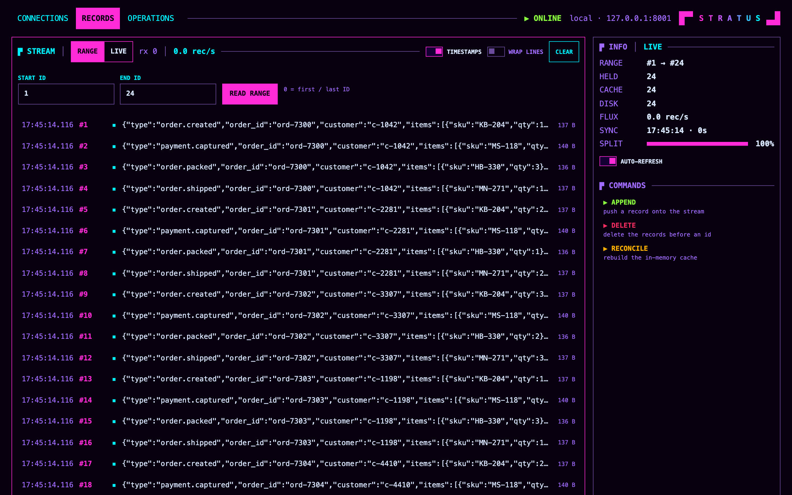
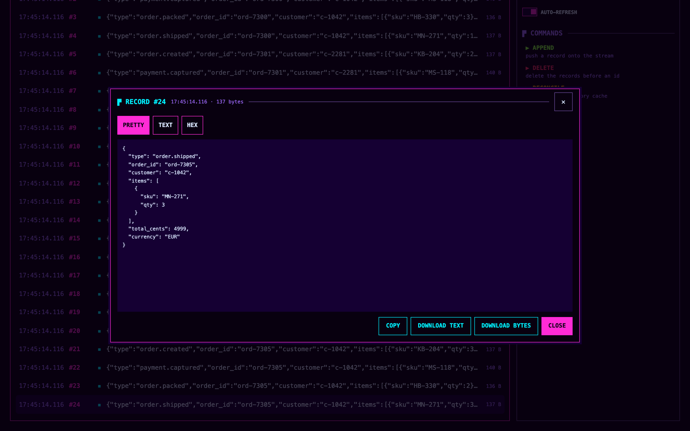
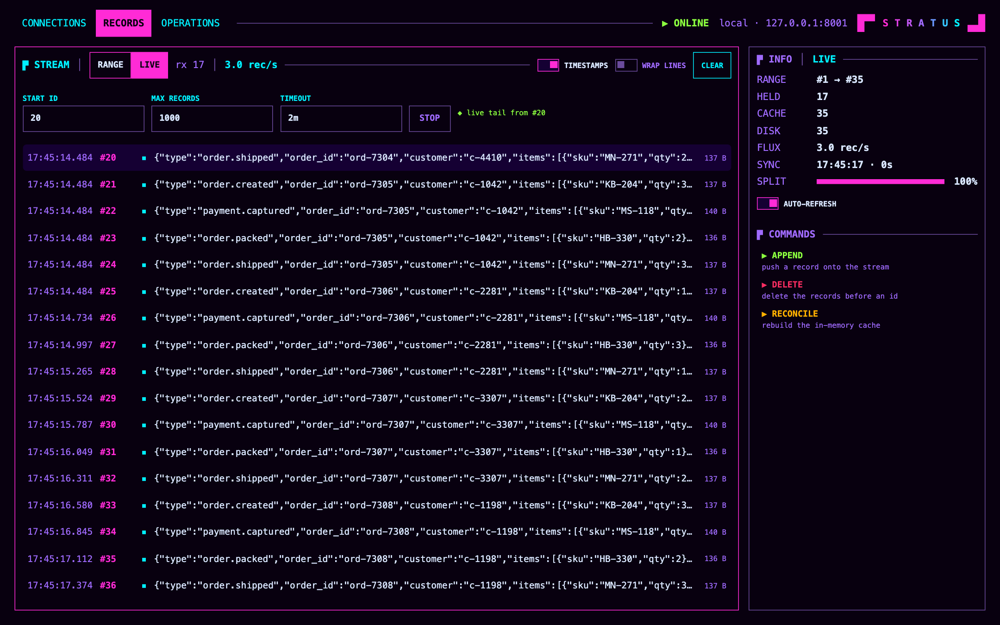
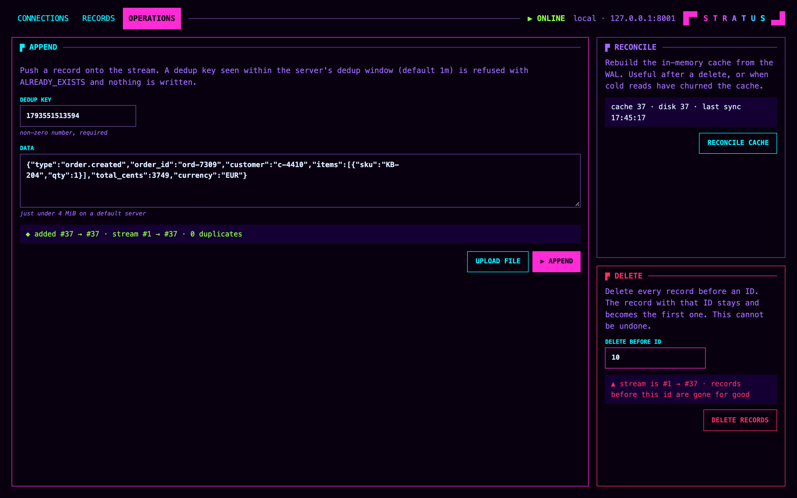
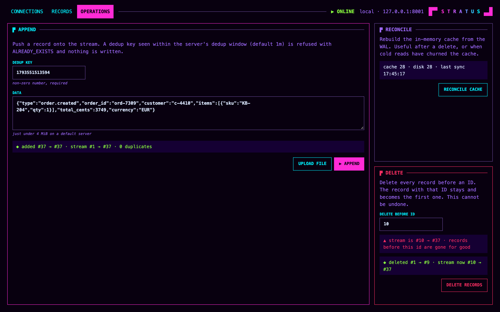
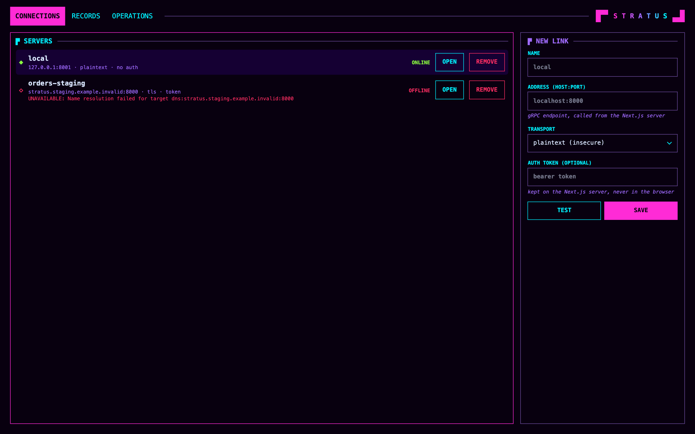
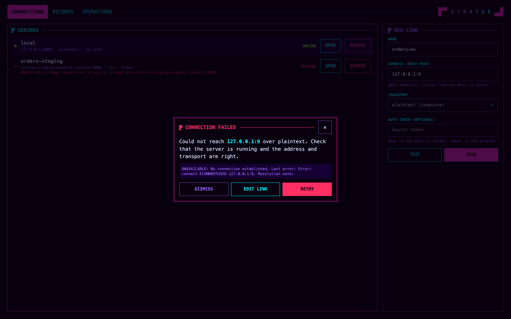

# stratus-ui

Web console for [Stratus](https://github.com/barnowlsnest/stratus) streams: browse records, live tail, append, delete and reconcile. It talks gRPC to a Stratus server through [`ts-stratus`](https://github.com/barnowlsnest/ts-stratus), from the Next.js server only.



It is a single-user console with no login of its own, made to run on your machine or behind your own access control. See [Security](#security).

## What it looks like

These are captures of the real console against a real Stratus server, with made-up order events as the data.

**Inspect a record.** Click any record to read its payload as formatted JSON, text or hex, then copy it or download it.



**Watch records arrive.** Live mode follows the stream from any ID and shows the arrival rate.



**Append a record.** Type a payload or upload a file. The result shows the ID it was given and the stream's new range.



**Trim the stream.** Delete removes the records before an ID and reports what went. The record with that ID stays.



**Manage servers.** Every saved server is checked when the page opens, and one that is down shows the reason. Tokens stay on the Next.js server.



**Test before saving.** A link that cannot be reached explains why, and you can retry or edit it.



## Behavior and limits

Measured against `barnowlsnest/stratus`:

- **Delete** removes the records before the ID you enter. The record with that ID stays and becomes the first one, so a stream cannot be emptied. The Stratus server behaves this way, and the form says so.
- **Append** takes records just under 4 MiB on a default server. A dedup key seen within the server's dedup window (default 1m) is refused with `ALREADY_EXISTS` and nothing is written.
- **Range reads** show at most 500 records. A response over 32 MiB is refused with a message to narrow the range, so records averaging over about 65 KB need a narrower range than the default window.
- **Live tail** returns exactly MAX RECORDS (up to 100,000) with a timeout of up to 3600s. A batch over 32 MiB stops the tail with a message to lower MAX RECORDS or start later. Closing a tab ends the gRPC call on the next record or at the timeout.
- **Request bodies** are limited to 12 MiB for operations and 64 KiB for connection forms.
- IDs and counts above 2^53 are refused rather than rounded.

## Development

Requires Node 24.21.0 or newer (`nvm use` reads `.nvmrc`).

```bash
npm ci
npm run dev        # http://localhost:3000
npm run typecheck
npm run build
```

GitHub Actions (`.github/workflows/ci.yml`) runs the typecheck, the build, a Docker image build and the end-to-end tests on every pull request and every push to `main`. It publishes nothing.

### End-to-end tests

The tests drive the production build through its API and a real browser, against a real Stratus. They write and delete records, so they only ever talk to `127.0.0.1:8001`, a throwaway server you start first:

```bash
docker build -t stratus-e2e -f app.Dockerfile https://github.com/barnowlsnest/stratus.git#v1.6.0   # or any release tag
docker run -d --rm --name stratus-scratch -e WAL_DIR=/usr/wal -e HOST=0.0.0.0 \
  -p 127.0.0.1:8001:8000 stratus-e2e

npx playwright install chromium    # once
npm run test:e2e
docker stop stratus-scratch
```

CI uses the latest Stratus release, built from source, and the latest commit on the `ts-stratus` default branch, not the commit pinned in `package.json`. A new upstream release can therefore fail a pull request that changed nothing related.

### Screenshots

`scripts/readme-screenshots.mts` regenerates `docs/screenshots`. With the throwaway server from the end-to-end section running and empty:

```bash
npm run build
rm -rf .next/standalone/.data
cp -R .next/static .next/standalone/.next/static
PORT=3100 HOSTNAME=127.0.0.1 STRATUS_ADDR=127.0.0.1:8001 node .next/standalone/server.js &
node scripts/readme-screenshots.mts
kill %1
```

## Docker

```bash
docker build -t stratus-ui .

docker run --rm \
  -p 127.0.0.1:3000:3000 \
  -v stratus-ui-data:/app/.data \
  -e STRATUS_ADDR=host.docker.internal:8000 \
  stratus-ui
```

`-p 127.0.0.1:3000:3000` is what keeps the console reachable from this machine only. A bare `-p 3000:3000` publishes it on every interface.

| Variable | Purpose |
| --- | --- |
| `STRATUS_ADDR` | Address of the default connection (default `localhost:8000`). Inside a container, `localhost` is the container itself; use `host.docker.internal` for a server on the host. |
| `STRATUS_TOKEN` | Bearer token for the default connection. |
| `STRATUS_UI_ALLOWED_HOSTS` | Comma-separated hostnames allowed besides `localhost`, `127.0.0.1` and `[::1]`. |

The default connection is only created on first start. Connections you add in the UI persist in the `/app/.data` volume.

## Security

The console has no login, so whoever can reach its port can use it, including its saved connections and their tokens. Run it on localhost, as the command above does. For remote access, put it behind something that authenticates, such as an SSH tunnel, a VPN or an authenticating reverse proxy.

- **Other websites are blocked.** Only the console's own pages can call its API. Requests from other sites and for other hostnames get a 403. Behind a reverse proxy or a custom hostname, list the hostnames in `STRATUS_UI_ALLOWED_HOSTS`.
- **Tokens stay on the server.** The browser never receives them. They are stored in plain text in `.data/connections.json`, with mode 0600.
